<!-- Pedro Philimon | Perfil GitHub inspirado en Simply Intelligence -->

 

### `~/about` 

Soy **Pedro Philimon**, estudiante de **Ingeniería en Informática en Duoc UC (Chile)** y fundador de [**Simply Intelligence**](https://simplyintel.cl). Creo software, interfaces y soluciones digitales para proyectos y negocios.

### `~/stack` 

### `~/startup` 

**Simply Intelligence** — desarrollo de software, soluciones web y automatización para empresas y emprendimientos. [Explorar el sitio web](https://simplyintel.cl).

### `~/projects`

**[Horly](https://horly-frontend.pages.dev/login)** · **[NovaShop](https://github.com/pablophdev/NovaShop)** · **[Simply Intelligence](https://simplyintel.cl)**

---

`pedro@simplyintel:~$` **Software Engineer**  ·  Santiago, Chile

[LinkedIn](https://www.linkedin.com/in/pedro-philimon/) · [GitHub](https://github.com/pablophdev) · [simplyintel.cl](https://simplyintel.cl)

